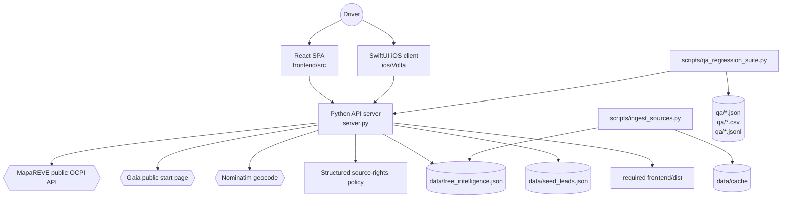

# Architecture

Volta is one backend process plus client surfaces. [server.py](../../server.py)
is a stdlib-only HTTP server that handles JSON routes, fetches live public
sources, enriches station rows, and serves the built React app. The React SPA in
[frontend/src](../../frontend/src) is the only web UI; the server refuses to
start when `frontend/dist` is absent. The native iOS client in
[ios/Volta](../../ios/Volta) consumes the same `/api/chargers` and
`/api/geocode` contracts.

State is intentionally simple. Live API responses are cached in memory for short
TTL windows. The static public-source intelligence database lives in
[data/free_intelligence.json](../../data/free_intelligence.json), and manual
leads live in [data/seed_leads.json](../../data/seed_leads.json). QA state is
file-backed in [qa](../../qa), with latest JSON reports regenerated by scripts
rather than hand-edited.

## Components

- **Python API/data engine** - [modules/backend-server.md](modules/backend-server.md)
  covers routes, cache behavior, static serving, and response assembly.
- **Honesty engine** - [modules/data-honesty-engine.md](modules/data-honesty-engine.md)
  explains rejection, verification, decision, pricing, parking, and corroboration.
- **Live source adapters** - [modules/live-sources.md](modules/live-sources.md)
  documents GET/public source integrations and merge rules.
- **React SPA** - [modules/frontend-spa.md](modules/frontend-spa.md) and
  [modules/frontend-components.md](modules/frontend-components.md) cover app state,
  queries, map/list/card rendering, and fail-closed behavior.
- **Intelligence builder** - [modules/intelligence-ingestion.md](modules/intelligence-ingestion.md)
  covers public static sources and safe refresh.
- **QA evidence system** - [modules/qa-regression.md](modules/qa-regression.md)
  covers unit, browser, canary, manual, and artifact checks.
- **iOS client** - [modules/ios-client.md](modules/ios-client.md) covers the native
  SwiftUI/MapKit consumer of the same API.

## System Diagram

## Request Data Flow

1. **Client mode chooses endpoint shape** - [frontend/src/lib/api.ts](../../frontend/src/lib/api.ts)
   builds `/api/chargers` with `overview=true`, `bbox`, `lat/lon`, `max_price`,
   `available`, `fast`, and `include_leads`.
2. **Server resolves viewport** - `resolve_viewport()` clamps explicit bbox or
   turns `lat/lon` into a bounded viewport.
3. **Source evidence is assembled** - fresh MapaREVE, eligible Gaia and reviewed
   Endolla/Spirii overlays can contribute live evidence within their actual scope.
   Feníe is a cached, attributed, Verify-first snapshot under owner-attested reuse
   permission, not live availability or independently verified licensing.
   Its marker-list POST and MapaREVE's query are narrow transport exceptions.
   Electromaps/Chargemap station evidence and Consum's locator remain excluded;
   typed Spain-only price annotations do not create pins or live authority.
   See the [current backend contract](../backend-engine.md#public-source-transport)
   and [structured source policy](../../data/source_policy_exclusions.json).
4. **Leads are loaded** - `load_all_leads()` normalizes the intelligence DB and
   seed leads, with bbox filtering before enrichment.
5. **Rows are enriched** - `enrich_station()`, `decision_for()`,
   `verification_profile()`, `ensure_claim_contract()`, and
   `apply_corroboration()` attach driver-facing facts.
6. **Coverage is summarized** - `live_coverage_profile()` decides standard vs
   degraded mode and emits warning text when live route-ready cards are sparse.
7. **Frontend chooses display data** - `chooseChargersData()` can show instant
   leads during live fetch and drops stale live rows on live failure.

## Key Design Decisions

- **Corroboration is not liveness.** Independent source count can raise
  confidence in existence/price but never sets `verification.live_verified`.
- **Charge and parking claims are separate.** `charge_claim`, `parking_claim`,
  and `claim_conflict` survive into the UI so cheap charging cannot hide costly
  or conditional parking.
- **Stale fallback is explicit.** Stale cache is labeled and current filters are
  reapplied before display.
- **Map is enhancement.** If MapLibre or tiles fail, the list remains the primary
  usable surface.
- **Backend stays stdlib-only.** Python scripts/tests/server avoid third-party
  dependencies; frontend uses a contained npm toolchain.

## Risky Areas

- Provider public surfaces can change shape or block cloud IPs.
- Virtualized DOM means browser tests can only assert mounted rows, not all
  records.
- `data/cache` and `data/source_probe` are local evidence/cache surfaces and are
  excluded from container/git packaging.
- Completion artifacts are themselves product checks; do not hand-edit
  `qa/*-latest.json`.
