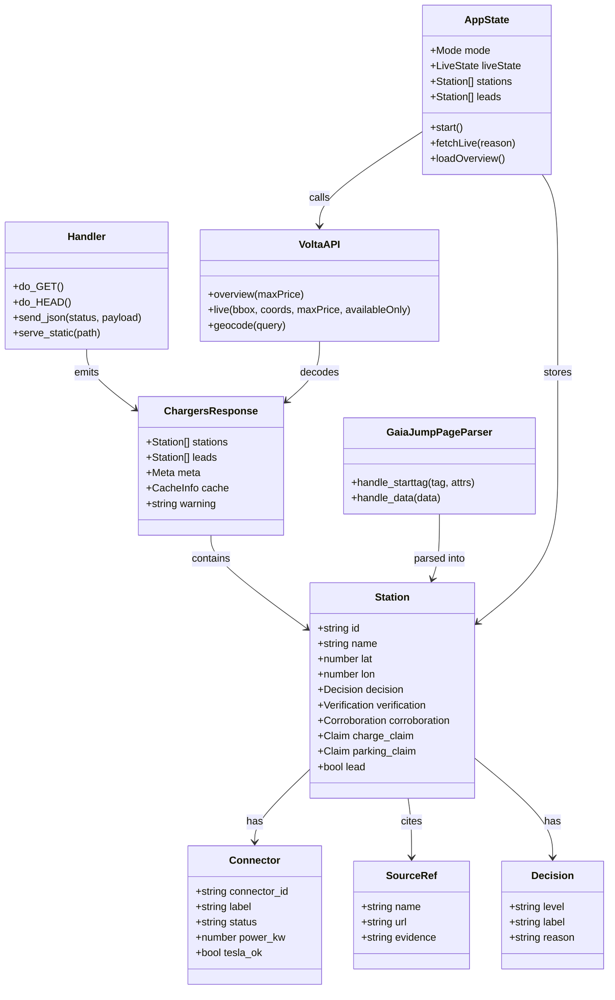

# Class Diagram

Volta is mostly function-first Python and React, so this diagram focuses on the
real class/type surfaces that cross module boundaries: the HTTP handler, API row
shapes, and iOS state/client models.

## Notes

- TypeScript and Swift both mirror the enriched Python row shape, but most row
  fields are optional because source coverage varies.
- Unknown backend decision levels are handled forward-compatibly by frontend and
  iOS helpers rather than crashing the UI.
