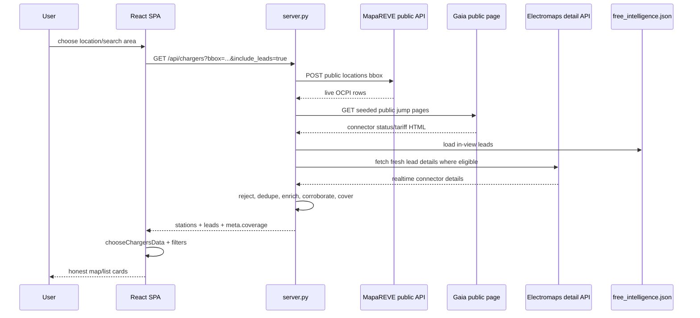
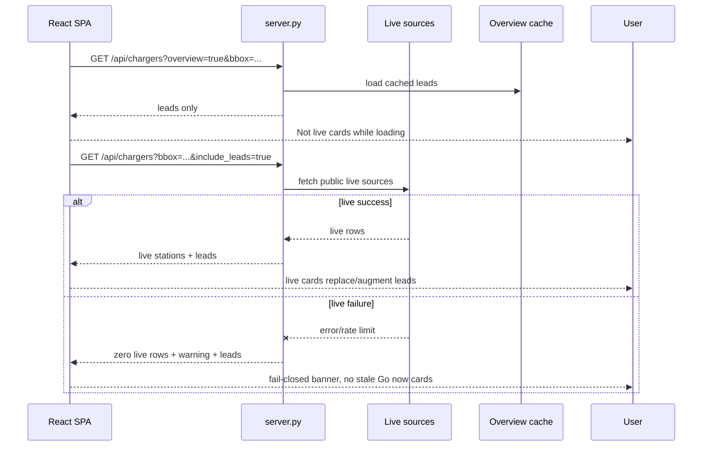
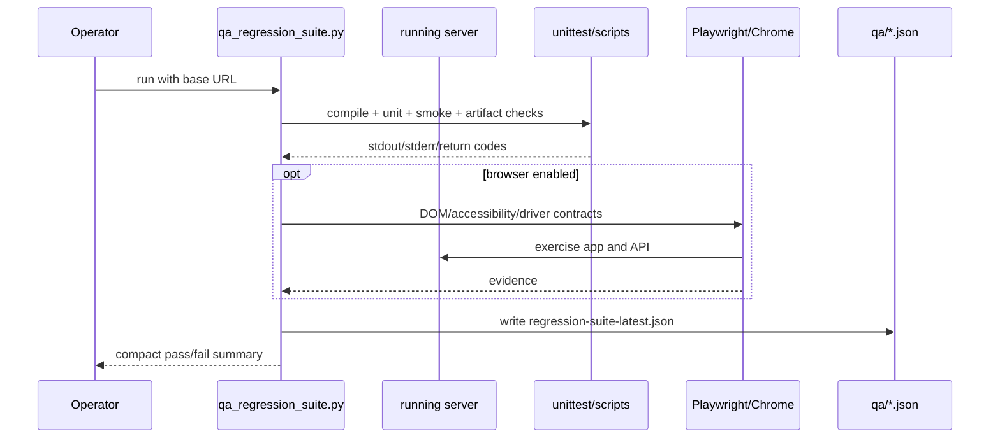

# Sequence Diagrams

## Workflow: Live Viewport Fetch

The user locates/searches/pans into live mode; Volta fetches live sources and
source-backed leads for the current viewport.



### Walkthrough

1. **Client request** - `useChargers()` in
   [frontend/src/lib/api.ts](../../../frontend/src/lib/api.ts).
2. **Server orchestration** - `live_response()` in [server.py](../../../server.py).
3. **Source fetch/merge** - `fetch_mapareve()`, `fetch_gaia_live()`, and
   `fetch_electromaps_live()`; structured source policy filters every response path.
4. **Honesty enrichment** - `reject_station_reason()`, `enrich_station()`,
   `apply_corroboration()`, `live_coverage_profile()`.

## Workflow: Intelligence-First Render And Fail-Closed Error

Live mode starts with quick leads and replaces them with live rows only when the
live response succeeds.



### Walkthrough

1. **Parallel queries** - `App.tsx` mounts live and instant overview queries.
2. **Selection guard** - `chooseChargersData()` in
   [frontend/src/lib/format.ts](../../../frontend/src/lib/format.ts).
3. **Failure disclosure** - `CoverageBanner` and the live-failed banner in
   [frontend/src/App.tsx](../../../frontend/src/App.tsx).

## Workflow: Intelligence Refresh

The autonomous refresh builds and validates an exact candidate before entering
a four-artifact, fsync-backed rollback boundary. It is a multi-file transaction,
not a cross-file atomic visibility guarantee: any post-promotion failure restores
all four canonical artifacts and the index.

```mermaid
sequenceDiagram
    participant Operator
    participant Refresh as auto_refresh.py
    participant Ingest as ingest_sources.py
    participant Delta as qa_ingestion_delta.py
    participant Canary as qa_ingestion_canary.py
    participant Reports as completeness + Valencia reports
    participant Git
    participant DB as data/free_intelligence.json

    Operator->>Refresh: run safe refresh
    Refresh->>Ingest: build isolated candidate JSON
    Ingest-->>Refresh: rebuilt payload
    Refresh->>Delta: compare tmp vs canonical
    alt delta ok
        Delta-->>Refresh: ok
        Refresh->>Canary: validate exact candidate and candidate history
        Canary-->>Refresh: candidate evidence ready
        Refresh->>DB: begin rollback boundary; install gated DB + history
        Refresh->>Reports: generate reports from promoted canonical DB
        Reports-->>Refresh: completeness + Valencia reports ready
        Refresh->>DB: replace both reports; revalidate exact four-file set
        Refresh->>Git: stage exact four-path allowlist
        Git-->>Refresh: verify isolated commit parent and blobs
        Refresh->>Git: push pinned commit, verify remote tip
    else delta fails
        Delta--x Refresh: failure
        Refresh-->>Operator: abort before canonical DB write
    end
```

### Walkthrough

1. **Build** - [scripts/ingest_sources.py](../../../scripts/ingest_sources.py).
2. **Candidate gates** - delta and canary validate the exact candidate. Dry-run also
   generates SHA-bound reports without promotion.
3. **Real transaction** - [scripts/auto_refresh.py](../../../scripts/auto_refresh.py)
   installs the gated DB/history under a four-artifact rollback boundary, generates
   and replaces reports from the promoted canonical path, then owns four-path commit
   containment, pinned push verification, receipt, and rollback.
4. **Compatibility wrapper** - [scripts/refresh_intelligence.sh](../../../scripts/refresh_intelligence.sh)
   delegates to the transactional lifecycle.

## Workflow: Regression Suite

The QA suite records evidence instead of relying on a verbal "green".



### Walkthrough

1. **Check list** - `suite_checks()` in
   [scripts/qa_regression_suite.py](../../../scripts/qa_regression_suite.py).
2. **Execution** - `run_check()` captures subprocess evidence and timeouts.
3. **Report** - [qa/regression-suite-latest.json](../../../qa/regression-suite-latest.json).
